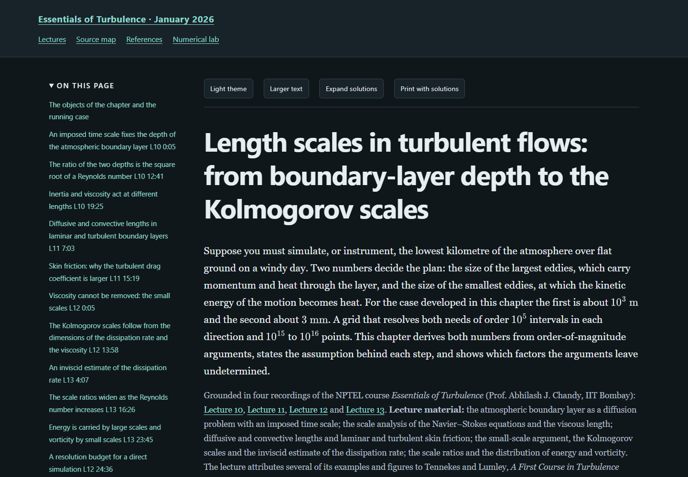

# Essentials of Turbulence — a textbook rewrite

**[Read the live textbook](https://az9713.github.io/nptel-essentials-of-turbulence-notes/)**

[](https://az9713.github.io/nptel-essentials-of-turbulence-notes/)

This project is an independent rewrite and expansion of Prof. Abhilash J.
Chandy's NPTEL IIT Bombay course, **Essentials of Turbulence**.
The **[January 2026 YouTube playlist](https://www.youtube.com/playlist?list=PLOzRYVm0a65e-DeX7ubGuWE_yBp9psdW7)
serves as the spine**: it sets the topic sequence and provides timestamped
anchors for the exposition.

Around that spine, the project develops explanations, definitions, derivations,
diagrams, runnable Python examples, and worked problems. Source maps distinguish
lecture material, research extensions, and original teaching constructions.
Chapter citations and sidecars record source uncertainties and unavailable
references.

All **56 exposition lectures** are covered in **20 chronological topic chapters**.
Lectures **57–60 and tutorials 1–2** supply practice material, giving **62 source
recordings**. The separate course introduction is outside the selected scope.
The notes contain **144 expandable solution disclosures** and **21 Python
listings**. Transcripts were produced locally with faster-whisper `small.en`;
they are machine transcriptions, not publisher captions.

The reader includes searchable chapter navigation, local MathJax, light/dark
themes, adjustable text size, expandable solutions, printing with solutions,
and a numerical-lab directory and launcher for the chapter programs.
Rendering assets are bundled, so a downloaded copy also works offline.

Explore the [source map](https://az9713.github.io/nptel-essentials-of-turbulence-notes/source-map.html),
[primary references](https://az9713.github.io/nptel-essentials-of-turbulence-notes/references.html),
and [numerical lab](https://az9713.github.io/nptel-essentials-of-turbulence-notes/numerical-lab.html).
The preview above opens the live GitHub Pages edition, served from `index.html`.

## Run locally

Open `index.html` after downloading the repository. To rebuild and check it:

```sh
python tools/build_book.py
python tools/validate_books.py --browser
python numerical_lab.py --list
python numerical_lab.py --chapter 5
python tools/check_chapter_code.py
python tools/check_package.py
```

Rebuilding and static checks use Python's standard library. Running chapter
programs requires NumPy. Browser checks require Python Playwright and an
installed supported browser. The laboratory launches existing chapter programs;
it does not provide a separate interactive turbulence simulator.

## Evidence and scope

All chapters are written and have recorded independent scientific reviews.
**Final independent sign-offs remain pending for chapters 3 and 16–20 and the
chapter 6 practice additions.** Their latest findings were subsequently repaired
and checked by the lead according to the saved handoff, but no later independent
zero-blocking verdict is recorded. Publication does not close those review gaps.
The original scientific chapter bodies are preserved byte-for-byte from the
completed local manuscript at commit `31a41f2`.

The [workflow](WORKFLOW.md), [source record](source-validation-summary.json),
[editorial record](editorial-review-summary.json), [content inventory](completion.json),
[code checks](chapter-code-validation.json), [reader checks](reader-validation.json),
[clean-export checks](source-free-validation.json), and [package checks](package-validation.json)
record the evidence and its limits. A clean Git export rebuilt all 25 HTML files
byte-for-byte and passed static checks and the chapter 5 launcher smoke test.
Code checks report execution and printed-output agreement separately from
scientific acceptance. Reader checks assess rendering and controls, not
mathematical correctness. A new independent whole-book scientific review,
full audiovisual review, and human accessibility certification are not claimed.
The [publication check](publication-validation.json) records served-file integrity,
live desktop/mobile controls, and the GitHub-rendered README preview.

Public files contain the rewritten textbook, supporting code, source citations,
and curated verification records. Raw recordings, transcripts, downloaded
papers, acquisition logs, and private editorial records remain outside this
repository. Published instructor and research-author names are retained for
source attribution. GitHub Pages serves the `main` branch at the repository root,
matching the other NPTEL reading editions.
